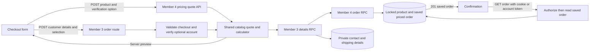

# Group 2 Member 3 — checkout integration with Member 4 pricing

## Dependency and review order

Member 4 owns all pricing. Review/merge their #40 (calculator), #41 (saved order/RPC) and #42 (POST /api/pricing/quote) before Member 3's #37 → #38 → #39. Their exact PR42 head `32a2a5d9251a5cc6beb40d0089ea697ac8436f2a` is merged into the local/backend branch with original authorship preserved; none of those PRs has been merged to main by Member 3. Until dependencies land, #37's diff includes Member 4 files.

No Member 4 pricing source, calculator, quote endpoint, original migration or tests was edited. The old Member 3 `checkout_pricing_rules`, `order_pricing`, revenue view and pricing trigger drafts were removed, along with `/api/checkout/pricing`. These were unapplied draft migrations in this session; if any teammate applied an older draft elsewhere, stop and coordinate a recovery migration instead of applying this clean schema blindly.

Member 3's replacement `20261109063222_member3_checkout_details.sql` follows Member 4's `20261108081033_add_revenue_pricing.sql`. It adds private contact/shipping/simulated-payment details, supports null buyers for GC2 guests and stores only their confirmation-token hash. It extends only the buyer-existence guard in Member 4's order RPC for null guest buyers; all snapshot validation, stale-price rejection and inventory logic are preserved. The details wrapper invokes that RPC with Member 4's complete pricing snapshot, then saves customer details in the same transaction.

## Request contract

Guest checkout defaults to no login. Optional accounts use Supabase Auth. A guest request sends:

```json
{
  "product_id": "<available product UUID>",
  "quantity": 1,
  "verification_option": "remote",
  "customer": {
    "full_name": "Test Buyer",
    "email": "test@example.com",
    "phone": "09123456789",
    "address": "123 Test Street, Manila"
  },
  "payment_method": "simulated_card",
  "payment_confirmed": true
}
```

`verification_option` follows Member 4 exactly: `none`, `remote`, `physical`, default `none`. The retired `inspection_requested` field is not used. Client money and buyer IDs cannot set saved values. Payment methods are `simulated_card`/`simulated_gcash`; no real card fields, payment, escrow transfer, refund or payout is performed.

Checkout POSTs product/quantity/verification to `/api/pricing/quote` and renders that server response, with loading, retryable error and empty-cart states. Switching product/service invalidates the displayed quote; aborted/stale selections cannot enable submission. POST /api/orders independently invokes Member 4's `quoteCatalogPricing`, then passes its scalar snapshot to the atomic details RPC. The quote is read-only and does not reserve stock.

## Saved pricing contract

Pricing comes directly from fields on Member 4's `orders` row: `unit_price`, `subtotal_amount`, `verification_option`, `verification_fee`, `commission_rate_bps`, `commission_amount`, `seller_payout_amount`, `platform_revenue_amount`, and `total_amount`. Confirmation reads these saved fields; there is no separate Member 3 pricing-table lookup. Member 4's `src/lib/pricing/rules.ts` is the source of active rates/fees. Do not introduce another rules function or copy fees into UI logic.

At the referenced Member 4 revision, a PHP485,000 guitar produces:

| Verification | Buyer total | Seller commission | Seller payout | Platform revenue snapshot |
| --- | --- | --- | --- | --- |
| none | 485,000 | 38,800 | 446,200 | 38,800 |
| remote | 487,800 | 38,800 | 446,200 | 41,600 |
| physical | 493,500 | 38,800 | 446,200 | 47,300 |

These are worked examples, not a second source of active rules. Stored revenue fields describe the calculated snapshot; simulated pending orders are not proof of cash received. Inspection/verification completion and refunds belong to Member 4's operational contract, not an invented Member 3 status workflow.

## API routes and status codes

- `POST /api/pricing/quote` (Member 4): JSON product/quantity/verification; 200 quote, 400 invalid input/JSON, 404 unknown product, 409 unavailable stock, 500 server failure.
- `POST /api/orders` (Member 3): 201 saved order; 400 invalid fields/quantity; 401 invalid supplied login or legacy no-customer request without login; 403 self-purchase; 404 unknown product/profile; 409 unavailable stock or stale catalog price; 500 save/configuration failure. Customer details are required for guest checkout. Optional account identity is verified server-side.
- `GET /api/orders/:id` (Member 3): 200 saved order in `{ok:true,data:{order}}`; 401 missing access; 404 invalid/missing order, wrong guest credential or other buyer; 500 server/configuration failure. All order responses are private/no-store.

Guest confirmation uses an exact-order HttpOnly/SameSite=Strict cookie, Secure on HTTPS, valid seven days. Raw random access tokens never appear in JSON, URLs or JavaScript storage; only the hash is stored. Losing the cookie loses guest access; no recovery-email feature is implemented. Account confirmation requires the buyer's token. Private contact fields and guest hashes are not returned.

## Architecture and file/function trace



Files: `src/components/checkout.tsx` submit handler → `app/api/orders/route.ts` → `src/lib/validators/checkout-order.ts` / `src/lib/catalog/checkout-orders.ts` → Member 4 `src/lib/pricing/catalog.ts` (`quoteCatalogPricing`) → Member 4 `src/lib/pricing/calculate.ts` / `rules.ts` → `place_checkout_order` → Member 4 `place_catalog_order` → private details insert → 201/cookie → `src/components/order-confirmation.tsx` → `app/api/orders/[id]/route.ts` → saved order rendering. Optional authentication uses `src/components/buyer-account.tsx`; guest checkout is not gated by Auth.

## Local verification

- `npm test`: all 23 tests passed, including Member 4's calculator/catalog/quote/schema tests and Member 3's customer validation, guest credentials and ownership checks.
- TypeScript and changed-file ESLint passed.
- All migrations applied in timestamp order on disposable PostgreSQL17 with minimal Supabase Auth stubs. `tests/checkout.sql` passed: guest physical, guest remote, signed-in none, exact saved snapshots, stale-price/forged-total rejection, atomic rollback and private access. Assertions also verify no duplicate order_pricing table or checkout_pricing_rules function exists.
- Actual local Next.js → PostgREST → disposable PostgreSQL HTTP checks passed: all three quote choices (including ignored browser totals), invalid choice400, guest order201 with remote total487800, protected saved confirmation200, and sold-item409. Shared Supabase has not been changed.
- Automated review found no critical/important introduced mismatch. This is not a human PR review.

Fresh configured production build passed. Actual local desktop-browser guest flow passed: add a disposable PHP168,000 instrument, choose remote verification, observe fee2800/total170800, submit simulated customer/payment details, and reload the saved confirmation. No browser Console errors were captured. Evidence: `member3-member4-confirmation-local.png`.

Real Supabase Auth/email, phone-width usability, deployed checks and Challenge 2 evidence remain pending. Full lint still has the existing state-in-effect error in untouched cart-context. Local tests and synthetic fixtures do not replace deployed evidence.

## Team handoff

Member 2's unmerged #29/#31 overlap checkout/confirmation UI; choose/integrate the UI before merging both workstreams. Member 5 must count guest orders without requiring a users inner join and use Member 4's saved pricing fields. Owner-screen no-login work remains Member 5's responsibility. No cart, product or owner-screen code was changed here.

After review: apply the approved Member 4 migration followed by the new Member 3 details migration, configure private environment values, deploy, test the flow and capture Challenge 2 Network data and actual file/function hops. The hand-drawn diagram, human reviews, three merged code PRs and individual Challenge 5 recording remain required. Optional duplicate-request protection/rate limiting is not implemented; row locking prevents overselling.
